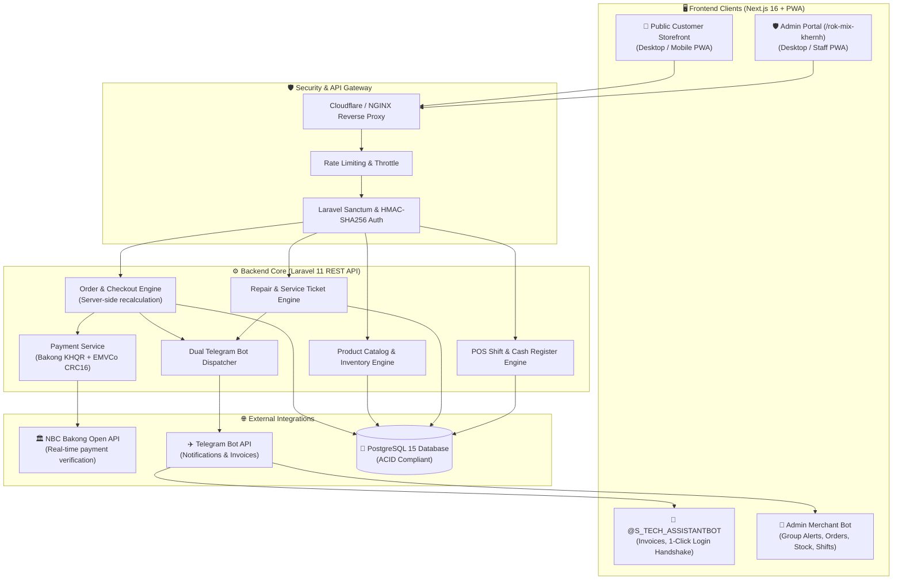

# 🚀 S Tech Store — Enterprise E-Commerce & Management Platform

[](https://nextjs.org/)
[](https://laravel.com/)
[](https://www.postgresql.org/)
[](https://www.typescriptlang.org/)
[](https://tailwindcss.com/)
[](https://bakong.nbc.gov.kh/)
[](https://telegram.org/)
[](https://serwist.pages.dev/)
[](#-cybersecurity--red-team-hardening)

---

## 📖 Overview

**S Tech Store** is a full-stack, enterprise-grade E-Commerce and Retail Operations Management system specially engineered for computer hardware, peripherals, custom PC building, and hardware repair services in Cambodia.

Built with a high-performance **Next.js 16 (App Router + Turbopack)** frontend and an ultra-robust **Laravel 11 REST API** backed by **PostgreSQL 15**, the platform integrates Cambodia's national standard **National Bank of Cambodia (NBC) Bakong Open API & EMVCo KHQR** payment gateway, dual Telegram bot automation, progressive web apps (PWA) for both customers and staff, and an obfuscated, high-security management portal.

---

## 🏛️ System Architecture



---

## ✨ Core Highlights & Features

### 🛒 1. Customer Experience (Storefront)
- **High-Velocity UI/UX**: Next.js 16 App Router with Turbopack, Framer Motion micro-interactions, dark & light themes, and Lucide icons.
- **Bilingual Support (Khmer & English)**: Complete native localization (`km` and `en`) powered by `next-intl`.
- **Intelligent Search & Filtering**: Real-time instant search dropdown with live pricing/stock previews, faceted filters (Category, Brand, Price Range, CPU/GPU/RAM specs), and sorting.
- **Dynamic Slide-Over Cart**: Flyout drawer accessible from any page, real-time quantity validation against live stock, and free delivery calculators.
- **Custom PC Builder (`/build-pc`)**: Interactive component compatibility calculator (CPU socket, RAM type, PSU wattage check, real-time total build cost computation, and 1-click cart migration).
- **Repair Service Booking (`/services`)**: Online service booking, repair tracking, and laptop/PC maintenance quotes.
- **Customer VIP Profile & Wallet**: Order history timeline with live driver contact info, saved addresses, wishlist, viewed items, and 2FA OTP security settings.
- **Dual PWA**: Standalone installable app on iOS Safari and Android Chrome with offline fallback capability.

### 💳 2. National NBC Bakong Open API & KHQR Payments
- **EMVCo Compliant KHQR Generator**: Generates real-time, dynamic KHQR codes with CRC16 CCITT polynomial checksum.
- **Live Status Polling & Webhooks**: Integrated directly with Bakong Open API JWT Bearer token for instant transaction confirmation and sound alerts upon payment.
- **ABA Bank Merchant Integration**: Configured for account `014 579 634` (`NOB ROTANA`) with exact merchant tag and currency encoding (USD & KHR).
- **Cash on Delivery (COD)** & Direct Bank Transfer options.

### 🤖 3. Dual Telegram Bot Automation Infrastructure
| Bot Instance | Bot Username | Role & Features |
|---|---|---|
| **Bot #1 (Merchant/Staff)** | `@s_tech_storeBot` | Admin fulfillment bot. Dispatches grouped topic alerts to the private store staff channel for: New Orders, Low Stock Alerts, Shift Changes, and Hardware Repair Tickets. |
| **Bot #2 (Customer Direct)** | `@S_TECH_ASSISTANTBOT` | Customer companion bot. Powers 1-Click App Handshake Login (no password required) and dispatches instant digital receipts, order confirmation invoices, and delivery driver phone numbers directly to the customer's Telegram chat. |

### 🛡️ 4. Secret Admin Management Portal (`/rok-mix-khernh`)
- **Obfuscated Routing**: Hidden `/rok-mix-khernh` URL protects the management interface against brute-force crawlers targeting standard `/admin` URLs.
- **Role-Based Access Control (RBAC)**: Super Admin, Admin, Manager, Cashier, and Technician roles with strictly enforced permission boundaries.
- **Orders Command Center**: Live order status updates (Pending → Confirmed → Processing → Out for Delivery → Completed / Cancelled), tracking numbers, and thermal/A4 invoice printing.
- **Product & Inventory Matrix**: Full CRUD catalog manager with category assignment, multi-image upload, rich specification JSON editor, profit margin calculation, and low-stock alerts.
- **Hardware Repair System**: Comprehensive repair ticketing (Device type, serial number, diagnosis notes, assigned technician, parts billing, and live status updates).
- **POS Cash Registers & Shifts**: Opening and closing cash drawer registers, variance reconciliation, cash drops, and end-of-shift receipts.
- **Promotions & Coupons**: Percentage or fixed discount coupons with usage thresholds and expiration dates.
- **Admin PWA Ready**: Optimized for iPad/tablet and mobile device home-screen installation for shop-floor staff.

---

## 🔒 Cybersecurity & Red Team Hardening

The application underwent rigorous **5-Stage Red Team Penetration Testing & Stress Hardening**:

1. **Stage 1 — Perimeter & Network Defense**:
   - Strict Content Security Policy (CSP), HSTS, `X-Frame-Options: SAMEORIGIN`, and `X-Content-Type-Options: nosniff`.
   - Global API rate limiting (`throttle:api`, 60 req/min for public endpoints; strict burst limiting on auth/checkout).
2. **Stage 2 — Authentication & Session Integrity**:
   - Zero-trust token handshakes using cryptographic `hmac_sha256` hash verification with Telegram Bot Secret.
   - Secure HTTP-only cookies, automated Sanctum token rotation, and password hashing using Bcrypt (cost factor 12).
3. **Stage 3 — Data Validation & Injection Shielding**:
   - 100% Parameterized queries via PDO/Eloquent to eliminate SQL Injection (SQLi).
   - Strict backend FormRequest validation, HTML tag stripping, and XSS sanitization across all customer inputs.
4. **Stage 4 — Business Logic & Financial Integrity**:
   - Strict server-side recalculation of cart pricing, discounts, and delivery fees (client prices are never trusted).
   - Database transactions with pessimistic row locking (`lockForUpdate`) on inventory deductions to prevent race conditions.
   - CRC16 mathematical validation on all generated KHQR strings.
5. **Stage 5 — RBAC Authorization & Audit Trails**:
   - Middlewares enforce role-based policy gates on all admin endpoints.
   - Sensitive credentials (`.env`, service account keys, API tokens) strictly excluded from version control.

---

## 🛠️ Technology Stack

### Frontend
- **Framework**: [Next.js 16.2.10](https://nextjs.org/) (App Router, Turbopack, React 19)
- **State & Data Fetching**: React Hooks, Context API, Native Fetch with ISR & revalidation
- **Internationalization**: [next-intl](https://next-intl-docs.vercel.app/) (Khmer `km`, English `en`)
- **PWA Service Worker**: [@serwist/next](https://serwist.pages.dev/)
- **UI & Icons**: [Tailwind CSS](https://tailwindcss.com/), [Lucide React](https://lucide.dev/), [Framer Motion](https://www.framer.com/motion/)
- **Theme**: `next-themes` (Dark/Light mode)

### Backend
- **Framework**: [Laravel 11.x](https://laravel.com/) (PHP 8.2+)
- **Database**: [PostgreSQL 15+](https://www.postgresql.org/)
- **Authentication**: Laravel Sanctum, Firebase Admin SDK, Telegram WebApp Auth
- **Payment Gateway**: NBC Bakong Open API, EMVCo KHQR Specification
- **Notification Services**: Telegram Bot API (Async HTTP client)

---

## 🚀 Quick Start Guide

### Prerequisites
- Node.js `20.x` or `22.x`
- PHP `8.2` or `8.3` (with `pdo_pgsql`, `openssl`, `mbstring`, `curl`, `gd` extensions)
- PostgreSQL `15` or higher
- Composer `2.x`

---

### 1. Backend Setup

```bash
cd backend

# Install PHP dependencies
composer install

# Copy environment template
cp .env.example .env

# Generate application key
php artisan key:generate

# Configure your database in .env:
# DB_CONNECTION=pgsql
# DB_HOST=127.0.0.1
# DB_PORT=5432
# DB_DATABASE=s_tech_store
# DB_USERNAME=your_username
# DB_PASSWORD=your_password

# Run migrations and seed data
php artisan migrate --seed

# Create storage symlink
php artisan storage:link

# Start development server
php artisan serve
# → Backend running at http://localhost:8000
```

---

### 2. Frontend Setup

```bash
cd frontend

# Install Node dependencies
npm install

# Copy environment template
cp .env.example .env.local

# Verify frontend configuration in .env.local:
# NEXT_PUBLIC_API_URL=http://localhost:8000/api
# NEXT_PUBLIC_TELEGRAM_BOT_ID=8689597792
# NEXT_PUBLIC_TELEGRAM_BOT_USERNAME=S_TECH_ASSISTANTBOT

# Start development server
npm run dev
# → Frontend running at http://localhost:3000
```

---

### 3. Production Build

```bash
# Frontend production build
cd frontend
npm run build
npm run start

# Backend optimization
cd backend
php artisan config:cache
php artisan route:cache
php artisan view:cache
```

---

## 🔐 Environment Variables Reference

### Backend (`backend/.env`)
```env
APP_NAME="S Tech Store"
APP_ENV=production
APP_DEBUG=false
APP_URL=https://api.yourdomain.com

DB_CONNECTION=pgsql
DB_HOST=127.0.0.1
DB_PORT=5432
DB_DATABASE=s_tech_store
DB_USERNAME=postgres
DB_PASSWORD=secret

# Telegram Bot #1 (Admin & Merchant Fulfillment)
TELEGRAM_BOT_TOKEN=your_merchant_bot_token
TELEGRAM_CHAT_ID=your_merchant_group_id

# Telegram Bot #2 (Customer Direct Invoices & Auth Handshake)
TELEGRAM_AUTH_BOT_TOKEN=8689597792:AAESJgFacj-eTx-3sDCQllT2A7d9Pm49mI8
TELEGRAM_AUTH_BOT_USERNAME=S_TECH_ASSISTANTBOT
TELEGRAM_AUTH_BOT_ID=8689597792

# Bakong KHQR Open API
BAKONG_OPEN_API_TOKEN=your_bakong_jwt_token
BAKONG_MERCHANT_NAME="NOB ROTANA"
BAKONG_MERCHANT_ACCOUNT="014 579 634"
```

### Frontend (`frontend/.env.local`)
```env
NEXT_PUBLIC_API_URL=https://api.yourdomain.com/api
NEXT_PUBLIC_SITE_URL=https://yourdomain.com
NEXT_PUBLIC_TELEGRAM_BOT_ID=8689597792
NEXT_PUBLIC_TELEGRAM_BOT_USERNAME=S_TECH_ASSISTANTBOT
```

---

## 📂 Project Directory Structure

```
S Tech Store/
├── backend/                        # Laravel 11 API Backend
│   ├── app/
│   │   ├── Http/Controllers/       # API & Admin Controllers
│   │   ├── Models/                 # Eloquent Models (Product, Order, User, Shift, etc.)
│   │   ├── Services/               # TelegramService, PaymentService, KHQRService
│   ├── config/                     # Application configurations
│   ├── database/
│   │   ├── migrations/             # PostgreSQL database migrations
│   │   └── seeders/                # Database seeders
│   └── routes/
│       └── api.php                 # REST API endpoints & security throttles
│
├── frontend/                       # Next.js 16 App Router Frontend
│   ├── app/
│   │   ├── [locale]/               # Localized routing (en / km)
│   │   │   ├── (auth)/             # Login, Register, Forgot Password
│   │   │   ├── (shop)/             # Products, Cart, Checkout, Profile, PC Builder
│   │   │   └── rok-mix-khernh/     # Obfuscated Admin Management Portal
│   │   ├── api/                    # Internal API routes
│   │   ├── manifest.ts             # PWA Webmanifest definition
│   │   └── sw.ts                   # Serwist Service Worker
│   ├── components/                 # Reusable UI widgets & components
│   ├── context/                    # Cart, Auth, and Wishlist React Contexts
│   ├── messages/                   # i18n translation dictionaries (en.json, km.json)
│   └── public/                     # Static icons, banners, and PWA assets
│
├── CLIENT_MANUAL_AND_FEATURES.md   # Complete Client Feature Guide & Operation Manual (Khmer & English)
└── README.md                       # This engineering documentation
```

---

## 📄 License & Attribution

Copyright © 2026 **S Tech Store**. All Rights Reserved.  
Engineered with premium enterprise standards for high reliability, security, and Cambodia retail speed.
