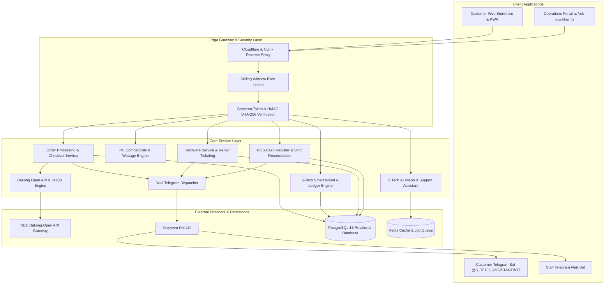

# S Tech Store

[](https://www.s-tech-store.tech)
[](https://www.s-tech-store.tech)
[](https://nextjs.org/)
[](https://laravel.com/)
[](https://bakong.nbc.org.kh/)
[]()

Production hardware retail platform, custom computer builder, and store management system built for the Cambodian technology market. The system connects a Next.js 16 storefront with a Laravel 11 backend, integrating National Bank of Cambodia Bakong KHQR payments, dual Telegram bot automation, progressive web applications, and an obfuscated operations portal.

📖 **Staff & Operations Manual**: [ADMIN_AND_STAFF_TRAINING_GUIDE.md](file:///d:/WEB%20Development/S%20Tech%20Store/ADMIN_AND_STAFF_TRAINING_GUIDE.md)  
📘 **Comprehensive Client & Features Manual**: [CLIENT_MANUAL_AND_FEATURES.md](file:///d:/WEB%20Development/S%20Tech%20Store/CLIENT_MANUAL_AND_FEATURES.md)  
📊 **Project Cost Estimation 2026**: [PROJECT_COST_ESTIMATION_2026.md](file:///d:/WEB%20Development/S%20Tech%20Store/PROJECT_COST_ESTIMATION_2026.md)

---

## 🚀 Release v1.3.0 (Executive Hardware Console & Real Gmail Engine)

* **Version**: `v1.3.0`
* **Build Identifier**: `20261019.01`
* **Release Date**: October 19, 2026
* **Status**: Production Stable (Live)

### 🌟 Key Highlights & Changelog in v1.3.0:
1. **🎛️ Executive Hardware Console / Cockpit Rack (Grand Master Controls)**:
   - Complete architectural redesign of the store state command console with a clean executive cockpit aesthetic (`bg-[#0c1017]`), discrete status LEDs, tactile switches, and monospace telemetry.
   - **Zero Emojis & Zero AI Vibe Glow**: Stripped all generic emojis and neon glowing halos for a professional enterprise feel.
   - 4 discrete decks:
     - `DISPATCH // 01` — **Normal 24/7 Live**: Discrete `SYS.ACTIVE` emerald status indicator and live switch.
     - `DISPATCH // 02` — **Vacation & Break Mode**: Monospace digital countdown `[ 03d : 00h : 00m : 00s ]` with automated storefront reopening upon expiration.
     - `DISPATCH // 03` — **Maintenance Lockdown**: Technical maintenance mode with safety verification modal.
     - `DISPATCH // 04` — **Night Lock Schedule**: Automated overnight lockdown (02:00–06:00 AM ICT) and manual force switch.
2. **📧 Real Gmail Automated Email Engine (`stech.supporter@gmail.com`)**:
   - Integration with Google Workspace SMTP & Resend API for automated customer communication.
   - Auto-welcome email dispatch with official store branding exclusively for authentic Google/Gmail sign-ins (filtering unverified manual accounts).
   - Automated delivery of digital receipts, 2FA security OTPs, password reset links, and repair tickets.
3. **✈️ 1-Click Telegram Bot Deep Link in All Customer Emails**:
   - Injected dark-slate 1-click companion bot card into all email templates (`https://t.me/S_TECH_ASSISTANTBOT?start=tglink_...`).
   - Tapping the link directly launches Telegram, auto-pairs customer accounts, and delivers notifications straight to their 1-on-1 private inbox.
4. **🛡️ 2FA OTP Cross-Profile Auto-Healing & Gmail Fallback**:
   - Cross-profile discovery automatically resolves and binds missing `telegram_chat_id` from existing accounts matching handle or email.
   - Immediate 1-click fallback button in 2FA modal to receive OTP via Gmail if Telegram is unavailable.
   - Replaced browser `alert()` popups with user-friendly in-app toast modals and rate-limit retry handling.

---

## 🚀 Release v1.2.0 (Production Master Edition)

* **Version**: `v1.2.0`
* **Build Identifier**: `20261016.01`
* **Release Date**: October 16, 2026
* **Status**: Production Stable (Live)

### 🌟 Key Highlights & Changelog in v1.2.0:
1. **📊 Real-Time Database Pagination (20 Accounts / Page) & Dynamic Search**:
   - Backend controller (`UserController.php`) refactored with server-side slicing, delivering 20 records per page.
   - Dual UI controls: numbered pagination (`1, 2, 3...`) and instant "Load More (+20 accounts)" append button.
   - 350ms debounced dynamic search querying real database records by name, email, phone, Telegram handle, and city.
2. **🔐 Dual Authentication Architecture & Channel Categorization**:
   - Explicit separation and counting for **Firebase / Google Auth** (Web users) and **Telegram Bot OAuth** (PostgreSQL Mini App users).
   - Resolved stat discrepancies: contextual role cards ensure active customer totals strictly match the viewing tab.
   - Distinct visual badges (`🔥 Google Auth`, `✈️ Telegram Bot`, `🔗 Linked`) rendered across user profiles.
3. **🤖 Automated Nightly & Weekly Telegram Analytics Reports**:
   - Automated 8:00 PM (Monday–Saturday) analytics broadcast summarizing daily visitors, total orders, revenue, and top-selling items directly to the staff group.
   - Weekly Sunday executive sales summary detailing trending products and new customer acquisition.
4. **⚡ Real-Time Product Management & Telegram Audit Alerts**:
   - Product Add, Edit, and Delete operations synchronize instantly with both admin UI and public storefront without requiring manual page reloads.
   - Instant real-time Telegram audit alerts sent to the staff channel when products are created, modified, or removed.
5. **🎫 Quick Customer Auto-fill on Repair Tickets**:
   - One-click customer profile selector querying real database records, auto-populating contact details on repair tickets.
6. **🏷️ Instant Real-Time Promotion Removal**:
   - Evicts deleted promotions immediately from the storefront checkout UI upon removal in the admin dashboard.
7. **🛡️ 401 Session Auto-Recovery & Persistent Authentication**:
   - Multi-layered token persistence protecting System Owner and Admin accounts against 401 session expirations during device sleep and background states.

---

## 🚀 Release v1.1.0 (Enterprise Production Edition)

* **Version**: `v1.1.0`
* **Build Identifier**: `20261013.02`
* **Release Date**: October 13, 2026
* **Status**: Production Stable (Live)

### 🌟 Key Highlights & Changelog in v1.1.0:
1. **⚡ Zero-Latency Telegram Bot & Webhooks**:
   - Implemented direct `answerCallbackQuery` fast-ack within the Webhook controller, completely eliminating the perpetual "Loading in server..." spinner on mobile Telegram.
   - Decoupled heavy background tasks using PHP `fastcgi_finish_request()` and local-first memory caching (`Cache::remember`).
   - Integrated intelligent cache eviction hooks (`booted` listeners) on `UserProfile`, `WalletTransaction`, and `Order` models.
2. **🪙 Real-Time Coin Rewards & Auto-Popup**:
   - Engineered client-side browsing activity listeners that detect authentic engagement on product pages.
   - Pops up an interactive reward modal with particle animations without requiring users to navigate to their account profile to claim manually.
3. **🎁 $5.00 USD Welcome Gift Integration**:
   - Automated initial account welcome credits, depositing $5.00 USD directly into customer S-Tech Wallets for use on store merchandise.
4. **💳 Universal Payment Engine**:
   - Unified National Bank of Cambodia Bakong KHQR dynamic EMVCo payloads.
   - Dedicated ABA Mobile deep linking (`aba://` / `abamobile://`) locking exact transaction sums.
   - Integrated international Credit / Debit Card checkout module (Visa, Mastercard, JCB).
5. **📧 Account Settings Gmail Synchronization & Direct Alerts**:
   - Added email address validation in customer account profile settings.
   - Syncs real customer emails directly into the Operations portal for one-click admin email dispatch and order notifications.
6. **🛡️ Grand Master Command Console & Store Operating Modes**:
   - **Store Public UI Switcher**: System Owner can seamlessly transition the public storefront between Normal 24/7 Live, Vacation / Temporary Closure mode, and Technical Maintenance mode.
   - **Vacation Mode with Real-Time Countdown**: System Owner can specify custom closure duration (e.g., 1, 2, 3, 5, 7 days or custom hours). The storefront renders a luxury temporary closure overlay with real-time ticking countdown and **automatically re-opens and redirects back to the live store** once the countdown completes without requiring manual intervention.
   - **Global Staff & Sub-Admin Activity Lockdown**: Single-click killswitch allowing the System Owner to immediately freeze all subordinate administrator and staff mutation privileges (blocking product, category, order, and configuration writes with HTTP 423 Locked) and revoke non-superadmin tokens while preserving full owner control.
   - Provides live financial emergency lockouts, database snapshot creation, global cache flushes, and real-time PWA client update broadcasts.
7. **👥 Customer Identity & Deduplication Protection**:
   - Added database constraint enforcement and intelligent query deduplication in the customer management directory.

---

## Architecture Blueprint



---

## Core Engineering Modules

### 1. Payment Engine & KHQR Integration
The transaction engine follows the National Bank of Cambodia EMVCo KHQR standard for merchant payments in both United States Dollar and Khmer Riel currencies.
* **EMVCo Tag Assembly**: Generates dynamic QR payloads with merchant account identifier, country code, currency definition, transaction sum, and CRC-16 CCITT polynomial checksum.
* **Open API Verification**: Interacts directly with the official NBC Bakong Open API via JWT bearer tokens, polling transaction settlement states and consuming webhook events.
* **Settlement Latency**: Incoming deposits trigger instant balance updates in under two seconds through direct API reconciliation without requiring manual human review.
* **Payment Redundancy**: Supports Cash on Delivery, debit or credit card settlement, and direct banking transfers alongside KHQR.

### 2. S-Tech Smart Wallet & Customer Loyalty System
A complete internal ledger system managing stored customer balances and loyalty rewards.
* **Dual-Currency Balances**: Balances are calculated in USD and converted to KHR using live official exchange rates.
* **Double-Entry Records**: Every top-up, item purchase, refund, or deduction creates immutable ledger entries with transaction identification references.
* **S-Coins Reward Algorithm**: Customers receive between one and three percent cashback in S-Coins upon order delivery, plus streak rewards ranging from ten to fifty coins per daily check-in.
* **Checkout Coin Deduction**: Customers can redeem S-Coins directly on the checkout screen at a fixed rate of one thousand coins per one US dollar discount.

### 3. Interactive PC Builder
An engineering utility helping customers configure custom desktop computer builds with real-time hardware compatibility checks.
* **Socket Compatibility Matrix**: Matches processor sockets with motherboard sockets, covering Intel LGA1700, AMD AM5, and AMD AM4 chipsets.
* **Memory Standard Validation**: Enforces DDR4 and DDR5 memory generation parity across motherboards and memory kits.
* **Dimension Clearance**: Checks graphics card physical length against chassis interior dimensions to prevent installation conflicts.
* **Power Budget Calculator**: Tallies combined thermal design power across central processors, graphics boards, fans, and storage drives, recommending certified power supplies with twenty to thirty percent headroom.
* **Instant Export**: Allows customers to save quotes, generate PDF summaries, or migrate the complete build into the shopping cart with a single action.

### 4. Dual Telegram Bot Infrastructure
A bifurcated notification and authentication architecture running two dedicated Telegram bot daemons.

| Instance | Identifier | Functional Responsibility |
|---|---|---|
| **Merchant Operations Bot** | Store internal bot | Dispatches real-time grouped operational alerts into private staff channels for newly placed orders, critical inventory warnings, shift openings or closures, and hardware service tickets. |
| **Customer Direct Assistant** | `@S_TECH_ASSISTANTBOT` | Manages customer communication by delivering digital invoices, tracking numbers, driver phone contacts, and providing passwordless one-click authentication tokens. |

* **Cryptographic Handshake**: Customer logins via Telegram use HMAC SHA-256 signature verification computed against the bot authentication token to guarantee session validity without transmitting passwords.

### 5. S Tech AI Diagnostic & Support System
An integrated multimodal assistant designed to provide customer support and technical hardware troubleshooting.
* **Hardware Vision Analysis**: Evaluates customer photos to diagnose Windows stop errors, blue screen bug checks, BIOS configurations, motherboard port connections, and laptop specification labels.
* **Platform Knowledge Base**: The assistant maintains complete awareness of store catalog inventory, shipping rates, repair workflows, PC builder rules, and payment policies.
* **Live Profile Context Injection**: When an authenticated user opens chat, the assistant automatically consumes account profile data, current wallet balance, accumulated coins, and active order counts to answer personal account queries accurately.
* **Token Abuse Defense**: Employs a sliding-window rate limiter that bans abusive network addresses for ten minutes whenever request velocity exceeds twelve requests within thirty seconds.

### 6. Retail Operations & Store Management Portal
An administrative portal located behind the obfuscated route `/rok-mix-khernh` to protect administrative interfaces from automated credential stuffers.
* **Role-Based Access Control**: Grants specific permissions across Super Admin, Store Manager, Cashier, Inventory Clerk, and Repair Technician accounts.
* **Order Fulfillment Pipeline**: Tracks orders from pending state through processing, fulfillment, and delivery, supporting continuous thermal receipt printing.
* **Inventory Matrix**: Manages multi-image uploads, category trees, cost prices, selling prices, profit margins, and minimum stock threshold alerts.
* **Hardware Repair Workshop**: Logs intake device details, serial numbers, customer fault descriptions, technician assignments, replacement part costs, and customer pickup statuses.
* **Cash Drawer Shifts**: Enforces cash drawer opening balances, mid-shift cash drops, expected cash totals, and variance reconciliation at shift closure.

---

## Technical Specifications

### Frontend Application
* **Framework**: Next.js 16.2.10 running on Node.js 20 or 22
* **Rendering Architecture**: React 19 App Router with Turbopack compilation
* **Styling & Animation**: Tailwind CSS with Framer Motion transitions
* **Localization**: Complete native Khmer and English localization through next-intl
* **Service Worker**: Serwist offline service worker providing installable PWA behavior on mobile platforms
* **Theme Support**: Next-themes dark and light interface modes

### Backend API & Services
* **Framework**: Laravel 11 on PHP 8.2 or 8.3
* **Primary Database**: PostgreSQL 15 with relational integrity constraints and transaction isolation
* **Authentication**: Laravel Sanctum tokens combined with Firebase Auth integration
* **Banking Gateway**: National Bank of Cambodia Bakong Open API and EMVCo KHQR specifications
* **External Dispatchers**: Asynchronous Telegram Bot API HTTP clients

---

## System Hardening & Security Measures

1. **Perimeter Controls**: Enforces strict Content Security Policy headers, HTTP Strict Transport Security, and nosniff content protection alongside API throttling rules.
2. **Data Sanitization**: Uses Eloquent parameterized queries to eliminate SQL injection vulnerabilities, combined with HTML tag stripping on all customer inputs.
3. **Financial Isolation**: Cart totals, voucher deductions, and delivery fees are calculated strictly on the server; client prices are discarded during checkout.
4. **Race Condition Prevention**: Employs database row locking during inventory deductions to avoid overselling during flash sales.
5. **Credential Management**: Excludes sensitive API keys, database credentials, and service tokens from version control.

---

## Installation & Deployment Runbook

### Environment Requirements
* Node.js version 20.x or 22.x
* PHP version 8.2 or 8.3 with extensions: `pdo_pgsql`, `openssl`, `mbstring`, `curl`, `gd`
* PostgreSQL version 15 or higher
* Composer version 2.x

---

### Step 1. Backend Service Configuration

```bash
cd backend

# Install PHP dependencies
composer install --no-dev --optimize-autoloader

# Create environment configuration
cp .env.example .env

# Generate encryption key
php artisan key:generate

# Set up database credentials inside .env:
# DB_CONNECTION=pgsql
# DB_HOST=127.0.0.1
# DB_PORT=5432
# DB_DATABASE=s_tech_store
# DB_USERNAME=postgres
# DB_PASSWORD=your_secure_password

# Execute database migrations and seed baseline data
php artisan migrate --seed --force

# Link storage directory
php artisan storage:link

# Cache configuration for production
php artisan config:cache
php artisan route:cache
php artisan view:cache

# Start application server
php artisan serve
```

---

### Step 2. Frontend Application Configuration

```bash
cd frontend

# Install Node dependencies
npm install

# Create environment configuration
cp .env.example .env.local

# Build production distribution
npm run build

# Start production server
npm run start
```

---

## Environment Variables Configuration

### Backend Environment Configuration at `backend/.env`

```env
APP_NAME="S Tech Store"
APP_ENV=production
APP_DEBUG=false
APP_URL=https://api.yourdomain.com

DB_CONNECTION=pgsql
DB_HOST=127.0.0.1
DB_PORT=5432
DB_DATABASE=s_tech_store
DB_USERNAME=postgres
DB_PASSWORD=your_secure_password

# Staff Alert Telegram Bot
TELEGRAM_BOT_TOKEN=your_merchant_bot_token
TELEGRAM_CHAT_ID=your_staff_channel_id

# Customer Direct Telegram Bot
TELEGRAM_AUTH_BOT_TOKEN=8689597792:AAESJgFacj-eTx-3sDCQllT2A7d9Pm49mI8
TELEGRAM_AUTH_BOT_USERNAME=S_TECH_ASSISTANTBOT
TELEGRAM_AUTH_BOT_ID=8689597792

# National Bank of Cambodia Bakong Open API
BAKONG_OPEN_API_TOKEN=your_bakong_jwt_token
BAKONG_MERCHANT_NAME="NOB ROTANA"
BAKONG_MERCHANT_ACCOUNT="014 579 634"
```

### Frontend Environment Configuration at `frontend/.env.local`

```env
NEXT_PUBLIC_API_URL=https://api.yourdomain.com/api
NEXT_PUBLIC_SITE_URL=https://yourdomain.com
NEXT_PUBLIC_TELEGRAM_BOT_ID=8689597792
NEXT_PUBLIC_TELEGRAM_BOT_USERNAME=S_TECH_ASSISTANTBOT
NEXT_PUBLIC_GEMINI_API_KEY=your_gemini_api_key
```

---

## Repository Structure

```
S Tech Store/
├── backend/                       Laravel 11 REST API Backend
│   ├── app/
│   │   ├── Http/Controllers/      API and Admin Management Controllers
│   │   ├── Models/                Database Models for Orders, Products, Shifts
│   │   └── Services/              Bakong KHQR, Wallet, and Telegram Engines
│   ├── config/                    Application configuration files
│   ├── database/
│   │   ├── migrations/            PostgreSQL schema migrations
│   │   └── seeders/               Initial database seeders
│   └── routes/
│       └── api.php                Public and protected API routes
│
├── frontend/                      Next.js 16 App Router Frontend
│   ├── app/
│   │   ├── [locale]/              Localized application routes for Khmer and English
│   │   │   ├── (auth)/            Authentication pages
│   │   │   ├── (shop)/            Storefront, Catalog, Cart, Checkout, PC Builder
│   │   │   └── rok-mix-khernh/    Obfuscated Retail Operations Portal
│   │   ├── api/                   Next.js server-side API proxy routes
│   │   ├── manifest.ts            Progressive web application manifest
│   │   └── sw.ts                  Service worker definition
│   ├── components/                Reusable user interface components
│   ├── context/                   Client-side state management contexts
│   ├── messages/                  Translation dictionaries for Khmer and English
│   └── public/                    Static media assets and icons
│
├── CLIENT_MANUAL_AND_FEATURES.md  Client operation manual and feature documentation
└── README.md                      System engineering and architecture documentation
```

---

## Engineering Leadership

* **System Architect & Lead Engineer**: Rotana Nob  
* **Platform**: S Tech Store Cambodia  
* **Official Website**: https://www.s-tech-store.tech  

Copyright 2026 S Tech Store. All rights reserved.
